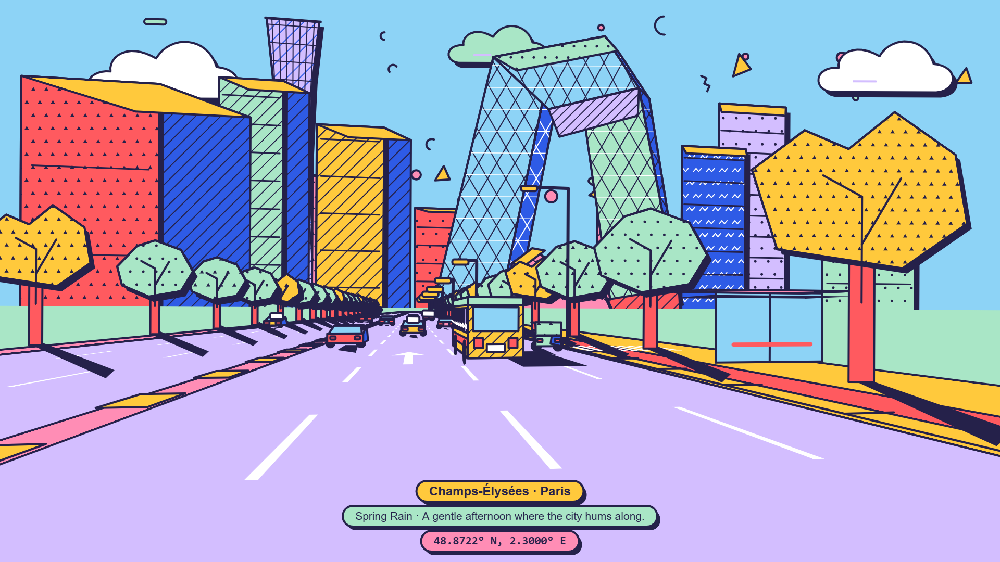

# memphis-city-drive

A 24-second, 1920x1080, 30 fps animation of a drive down a city avenue, drawn in a Memphis
style (flat palette, 4 px outlines, hard shadows, clipped patterns), with a soundtrack
synthesized in code. The caption names the Champs-Élysées. The scenery is invented and does
not depict the real avenue.



Every 60th frame: [output/contact_sheet.png](output/contact_sheet.png)

## How it works

- `MemphisFilm.frame(i, ctx)` draws frame `i` on a 2D canvas. It depends only on `i`, so any
  frame can be rendered alone and the output is byte-identical between runs.
- `src/events.js` holds one list of named events with frame numbers. The renderer and the
  audio script both read it, so picture and sound cannot drift apart.
- All randomness is mulberry32 seeded with `20261027`. No `Math.random`, no clock.
- Frames are exported as PNG from headless Chromium via puppeteer-core.
- The soundtrack (`scripts/audio.cjs`) is FM, additive and Karplus-Strong synthesis plus
  filtered noise, in C major pentatonic at 90 BPM. It is normalized to -14 LUFS with an
  internal BS.1770 meter and limiter, then written as 48 kHz stereo 16-bit WAV.
- ffmpeg muxes H.264 (CRF 18, yuv420p) and AAC.

Event timing and measured cue onsets: [output/events.md](output/events.md),
[output/audio_sync.md](output/audio_sync.md).

## Requirements

- Node 20 or newer
- Chrome or Edge. The scripts look in the default Windows install paths; on other systems, or
  for a non-default install, set `BROWSER_PATH` to the executable.
- ffmpeg and ffprobe with libx264

`scripts/build.ps1` uses `tools\node-v*-win-x64` and `tools\ffmpeg\bin` when present and
falls back to `PATH` otherwise. `build.ps1` is PowerShell. On other systems run the Node
scripts and ffmpeg directly; the ffmpeg arguments are in `build.ps1`.

## Build

```powershell
npm install
npm run build                                  # frames, audio, MP4, checks
node scripts/checkpoint.cjs                    # 4 stills, collage, palette strip, events.md
node scripts/checkpoint.cjs 372                # one frame to output/frame_0372.png
powershell -File scripts\build.ps1 -SkipAudio  # reuse output/soundtrack.wav
powershell -File scripts\build.ps1 -SkipFrames # reuse output/frames
```

A full build takes about 90 seconds for frames and 5 seconds for audio. The output goes to
`output/memphis_city_drive.mp4`.

`RENDER_WORKERS=4` renders on four pages at once and is about 2.5x faster, but Edge then
produces occasional one-level antialiasing differences. Leave it at 1 when you need
reproducible output.

## Layout

```
src/events.js            event list, fps, seed
src/renderer.js          frame(i, ctx)
index.html               canvas host page
scripts/browser.cjs      browser launch and frame capture
scripts/render-frames.cjs  all frames and the contact sheet
scripts/checkpoint.cjs   sample stills and collage
scripts/audio.cjs        soundtrack and sync report
scripts/build.ps1        full build and verification
```

## License

MIT. See [LICENSE](LICENSE).
